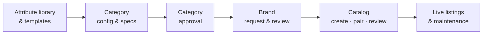

# Orbita · my-own-marketplace

Orbita is a multi-role marketplace platform for governed product catalogs: admins define categories once, sellers list products against those definitions with AI doing most of the typing, and reviewers only look at what is risky.

> **AI recommends. Orbita validates. Humans review exceptions.**

## Status

**Architecture and design phase.** No application code yet. The repo currently holds:

| Path | What it is |
| --- | --- |
| [`docs/architecture/`](docs/architecture/README.md) | Technical architecture: scope, roles, domain model, system design, workflows, tech stack, AI, roadmap |
| [`docs/adr/`](docs/adr/README.md) | Architecture Decision Records |
| [`docs/design/orbita-design-system.md`](docs/design/orbita-design-system.md) | Design tokens and UX patterns extracted from the prototype |
| [`docs/brainstorm/open-questions.md`](docs/brainstorm/open-questions.md) | Decisions still open, with defaults |
| [`prototype/orbita/`](prototype/orbita/README.md) | The original single-file Orbita seller prototype (UX reference; open `index.html` in a browser) |

## What the platform covers

Roles: platform admin, template manager, workgroup manager, category creator / drafter / checker / approver, vendor-assessment officer, brand specialist, agency manager, product reviewer, marketplace manager, committee, auditor, seller admin, seller lister, brand owner (OEM). See [roles and permissions](docs/architecture/02-roles-and-permissions.md).

## Planned stack

TypeScript monorepo (pnpm + Turborepo) · Next.js + React + Tailwind (Orbita design tokens) · NestJS API + worker · PostgreSQL (JSONB, full-text, pgvector) with Drizzle · pg-boss jobs · Better Auth + CASL · GoRules ZEN for rules · S3-compatible storage · provider-agnostic AI gateway. Details and reasoning in [06 · Tech stack](docs/architecture/06-tech-stack.md).

## Roadmap

M0 Foundations → M1 Library & taxonomy → M2 Category versions + contract → M3 Review engine + category approval → M4 Brands → M5 Catalog → M6 Maintenance + AI. See [08 · Roadmap](docs/architecture/08-repo-structure-and-roadmap.md).
