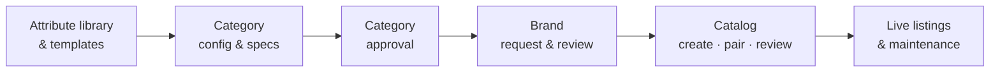

# Orbita · my-own-marketplace

Orbita is a multi-role marketplace platform for governed product catalogs: admins define categories once, sellers list products against those definitions with AI doing most of the typing, and reviewers only look at what is risky.

> **AI recommends. Orbita validates. Humans review exceptions.**

## Status

**R0, R0.1, R1, R1.1 and R2 built**: login for 8 roles, role-driven Orbita shell, users/roles/audit, the attribute library
(attributes, value lists, units, certificates, flags and flag profiles), a variable-depth category tree (groups and listing
categories) with aliases, workgroups and per-category attribute sets, adoption from the **Shopify Standard Product Taxonomy**
and **UNSPSC**, the **category configuration studio** (flags and profiles, specifications, typed rules, live seller-form preview, test cases) compiling each version into a hashed **Category Contract**, `/api/v1` with OpenAPI, CI. Next: R3 (category approval and publishing). **Deploying it:** [docs/setup/deploy-r0.md](docs/setup/deploy-r0.md).

| Path | What it is |
| --- | --- |
| [`apps/web/`](apps/web) | Next.js app (pages, `/api/v1` route handlers, adapters to Supabase and Resend) |
| [`packages/`](packages) | `ui` (Orbita design system), `authz` (roles + CASL), `db` (Drizzle schema), `domain`, `contract` (Category Contract compiler and evaluator), `modules/{identity,audit,library,standards,taxonomy,category-config}` |
| [`supabase/`](supabase/README.md) | SQL migrations and local Supabase config |
| [`docs/setup/deploy-r0.md`](docs/setup/deploy-r0.md) | Step-by-step: Supabase, Vercel, domain, email |
| [`docs/architecture/`](docs/architecture/README.md) | Technical architecture: scope, roles, domain model, system design, workflows, tech stack, AI, roadmap |
| [`docs/releases/`](docs/releases/README.md) | Release plan R0–R9 (plus R0.1, R1.1) with detailed scope, screens and exit demos |
| [`docs/adr/`](docs/adr/README.md) | Architecture Decision Records |
| [`docs/design/orbita-design-system.md`](docs/design/orbita-design-system.md) | Design tokens and UX patterns extracted from the prototype |
| [`docs/brainstorm/open-questions.md`](docs/brainstorm/open-questions.md) | Decisions still open, with defaults |
| [`prototype/orbita/`](prototype/orbita/README.md) | The original single-file Orbita seller prototype (UX reference; open `index.html` in a browser) |

## What the platform covers



Roles (8): platform admin, category manager, approver, reviewer, auditor, seller admin, seller staff, brand owner (OEM, assigned automatically). See [roles and permissions](docs/architecture/02-roles-and-permissions.md).

## Run it locally

Needs Node 22, pnpm 10 and (for the full stack) Docker with the [Supabase CLI](https://supabase.com/docs/guides/local-development).

```bash
pnpm install
supabase start                      # local Postgres, Auth, Studio on :54321–54324
cp .env.example apps/web/.env.local # paste the keys `supabase start` printed
pnpm db:migrate && pnpm db:seed     # tables + admin@example.com and the 5-account demo team
pnpm dev                            # http://localhost:3000
```

Checks: `pnpm lint`, `pnpm typecheck`, `pnpm test` (set `TEST_DATABASE_URL` to run the Postgres integration tests),
`pnpm depcheck` (module boundaries). Design system gallery: `/design`. API description: `/api/v1/openapi.json`.

## Stack

TypeScript monorepo (pnpm + Turborepo) · Next.js + React + Tailwind (Orbita design tokens) deployed on **Vercel** · API as Next.js route handlers over framework-free modules · Vercel Workflows + Cron for background jobs · **Supabase** Postgres (JSONB, full-text, pgvector), Auth and Storage · Drizzle · CASL authorisation · typed category rules compiled into a Category Contract · provider-agnostic AI gateway. Services and costs: [09 · Deployment](docs/architecture/09-deployment-and-services.md). Details and reasoning in [06 · Tech stack](docs/architecture/06-tech-stack.md).

## Releases

Ten releases plus two point releases in three milestones. Full scope per release: [docs/releases](docs/releases/README.md).

| Milestone | Releases |
| --- | --- |
| MVP · pilot | R0 Foundations · R0.1 Roles · R1 Library & taxonomy · R1.1 Standard taxonomies · R2 Config studio + contract · R3 Category approval · R4 Sellers & brands · R5 Catalog creation & approval |
| V1 · public launch | R6 Maintenance & versioning · R7 AI assist |
| V2 · scale | R8 Smart governance & bulk · R9 Growth & intelligence |

## Third-party data

`packages/modules/standards/data/shopify` contains a compact copy of the [Shopify Standard Product Taxonomy](https://github.com/Shopify/product-taxonomy) (release 2026-10), © Shopify, MIT licence ([LICENSE](packages/modules/standards/data/shopify/LICENSE)). UNSPSC is not included; operators upload it under their own terms.
