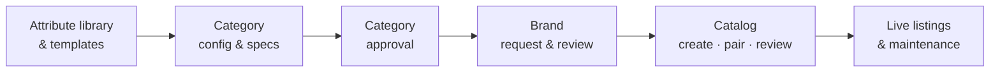

# Orbita · my-own-marketplace

Orbita is a multi-role marketplace platform for governed product catalogs: admins define categories once, sellers list products against those definitions with AI doing most of the typing, and reviewers only look at what is risky.

> **AI recommends. Orbita validates. Humans review exceptions.**

## Status

**Architecture and design phase.** No application code yet. The repo currently holds:

| Path | What it is |
| --- | --- |
| [`docs/architecture/`](docs/architecture/README.md) | Technical architecture: scope, roles, domain model, system design, workflows, tech stack, AI, roadmap |
| [`docs/releases/`](docs/releases/README.md) | Release plan R0–R9 with detailed scope, screens and exit demos |
| [`docs/adr/`](docs/adr/README.md) | Architecture Decision Records |
| [`docs/design/orbita-design-system.md`](docs/design/orbita-design-system.md) | Design tokens and UX patterns extracted from the prototype |
| [`docs/brainstorm/open-questions.md`](docs/brainstorm/open-questions.md) | Decisions still open, with defaults |
| [`prototype/orbita/`](prototype/orbita/README.md) | The original single-file Orbita seller prototype (UX reference; open `index.html` in a browser) |

## What the platform covers

Roles: platform admin, template manager, workgroup manager, category creator / drafter / checker / approver, vendor-assessment officer, brand specialist, agency manager, product reviewer, marketplace manager, committee, auditor, seller admin, seller lister, brand owner (OEM). See [roles and permissions](docs/architecture/02-roles-and-permissions.md).

## Planned stack

TypeScript monorepo (pnpm + Turborepo) · Next.js + React + Tailwind (Orbita design tokens) deployed on **Vercel** · API as Next.js route handlers over framework-free modules · Vercel Workflows + Cron for background jobs · **Supabase** Postgres (JSONB, full-text, pgvector), Auth and Storage · Drizzle · CASL authorisation · GoRules ZEN for rules · provider-agnostic AI gateway. Services and costs: [09 · Deployment](docs/architecture/09-deployment-and-services.md). Details and reasoning in [06 · Tech stack](docs/architecture/06-tech-stack.md).

## Releases

Ten releases in three milestones. Full scope per release: [docs/releases](docs/releases/README.md).

| Milestone | Releases |
| --- | --- |
| MVP · pilot | R0 Foundations · R1 Library & taxonomy · R2 Config studio + contract · R3 Category approval · R4 Sellers & brands · R5 Catalog creation & approval |
| V1 · public launch | R6 Maintenance & versioning · R7 AI assist |
| V2 · scale | R8 Smart governance & bulk · R9 Growth & intelligence |
