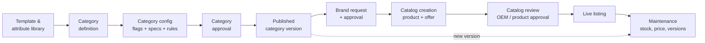

# 01 · Vision and scope

## The one-line version

Orbita is a multi-role B2B/B2G marketplace platform where **admins define categories once, sellers list products against those definitions with AI doing most of the typing, and reviewers only look at what is risky.**

## Why this is not "just a storefront"

In most marketplaces the hard part is the buyer side. Here the hard part is the **supply side governance chain**:

Every arrow carries data forward. A flag set during category configuration (say "price label = offer price with MRP, discount band 5–40%") changes what the seller's catalog form shows, which validations run, what the reviewer sees and what happens when the category gets a new version. **The architecture's main job is to make that chain explicit, versioned and testable.**

## Goals

1. **One platform, many roles.** Sellers, brand owners, category teams, reviewers and platform admins all log in to the same system and see only what their role allows.
2. **Config drives behaviour, not code.** Adding a category, a flag or a certificate rule must not need a deployment.
3. **Everything versioned and audited.** Every category version is immutable once published; every catalog is pinned to the category version it was created against; every decision is in an append-only audit trail.
4. **AI recommends, platform validates, humans review exceptions.** AI fills forms and drafts decisions with visible confidence; deterministic rules validate; humans handle low-confidence and high-risk cases.
5. **Looks and feels like the Orbita prototype.** Same tokens, components and UX patterns.

## Personas

| Persona | What they do | Lives in |
| --- | --- | --- |
| Platform super admin | Users, roles, tenants, system settings | Admin console |
| Template manager | Attribute library, flag profiles, certificate types, units, value lists | Admin console |
| Workgroup manager | Teams of drafters, checkers, approvers per category area | Admin console |
| Category creator | Creates category nodes in the taxonomy, assigns workgroup | Category workbench |
| Category drafter / checker | Configures flags, specs, dependencies; reviews drafts | Category workbench |
| Category approver | Approves and schedules category versions | Category workbench |
| Vendor assessment officer | Verifies seller identity and OEM status | Review desk |
| Brand specialist / agency manager | Reviews brand requests | Review desk |
| Product approval specialist | Reviews catalogs | Review desk |
| Marketplace manager / committee | Escalations, disputes, policy exceptions | Review desk |
| Seller (reseller) | Creates catalogs, pairs existing products, manages offers | Seller app |
| Brand owner (OEM) | Owns brands and catalogs, authorises resellers, approves reseller catalogs | Seller app (OEM view) |
| Seller org admin | Manages the seller's own users and divisions | Seller app |
| Auditor | Read-only access to audit trails | Admin console |
| Buyer | Searches, filters, compares, buys (later phase) | Buyer app |

## Scope by phase

> Superseded in detail by the [release plan](../releases/README.md) (R0–R9). The summary below still holds.

| Phase | In scope | Out of scope |
| --- | --- | --- |
| **MVP (Phase 1)** | Login + roles; attribute library; category tree; category config and specs with versions; category approval; brand request and review; catalog create / pair / clone against a category version; product approval review; audit trail; Orbita UI | Buyer app, orders, payments, bids, real government integrations |
| **Phase 2** | AI extraction and classification; risk-tiered review lanes; Action Centre for maintenance; variant families; bulk upload grid | Payments |
| **Phase 3** | Opportunity engine; AI category drafter; buyer search and comparison; external registry integrations | Full procurement / bidding |

## Non-functional requirements (initial targets)

| Area | Target |
| --- | --- |
| Auditability | Every state change and every field edit on governed objects recorded with who, when, before, after |
| Versioning | Category versions immutable after publish; catalogs pinned to a version |
| Security | OWASP ASVS L2 as the bar; role- and attribute-based authorisation on every API call |
| Availability | 99.5% to start (single region), designed to scale out later |
| Accessibility | WCAG 2.2 AA for all screens |
| Localisation | English first; i18n-ready strings (Hindi next) |
| Data residency | Deployable in an Indian cloud region |
