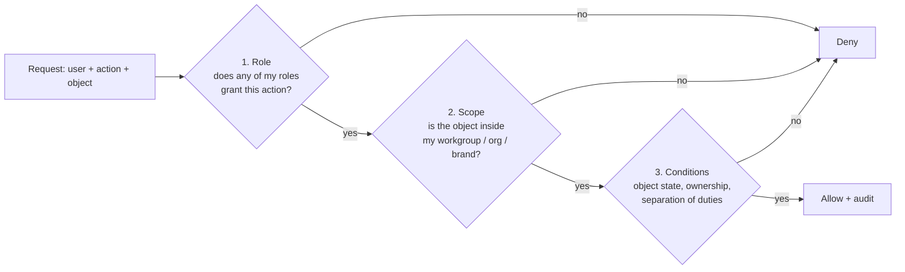

# 02 · Roles and permissions

Authorisation has three layers. A request is allowed only if **all three** say yes.

1. **Role (RBAC):** what kind of thing a user may do. Users hold one or more roles.
2. **Scope:** where they may do it. Platform-side roles are scoped to **workgroups** (a set of category subtrees). Seller-side roles are scoped to a **seller organisation** (and optionally a division), and brand-owner powers are scoped to the **brands** that organisation owns.
3. **Conditions (ABAC):** rules on the object itself. Examples: a drafter can edit a category version only while it is `DRAFT`; the approver of a version must not be the person who submitted it; a reseller can edit only the *offer* of a paired catalog, never the product facts.

## Role catalogue

### Platform side

| Role | Scope | Can do |
| --- | --- | --- |
| `platform_admin` | Global | Users, role grants, tenants, system settings. Cannot approve business requests (separation of duties) |
| `template_manager` | Global | Attribute library, units, value lists, Boolean pairs, flag profiles, certificate types, default limits |
| `workgroup_manager` | Global | Create workgroups, assign category subtrees, add members |
| `category_creator` | Workgroup | Create / rename / move category nodes, assign workgroup and checker |
| `category_drafter` | Workgroup | Edit draft category versions (flags, specs, rules) |
| `category_checker` | Workgroup | Everything a drafter can, plus assign drafters, review, send back, submit for approval, request classification edits |
| `category_approver` | Workgroup | Approve, schedule go-live, send back. Never on a version they edited |
| `va_officer` | Global or region | Review seller vendor assessments (OEM / deemed OEM status) |
| `brand_specialist` | Review queue | Review brand requests: approve, reject, ask for info, partial approve, escalate |
| `agency_manager` | Review queue | Everything a specialist can, plus take fresh requests, send back to specialist, revive brands |
| `product_reviewer` | Review queue | Review catalogs (product approval) |
| `marketplace_manager` | Global | Escalations, disputes, priority processing, policy exceptions |
| `committee_member` | Global | Vote on special cases referred by a marketplace manager |
| `auditor` | Global, read-only | Read audit trails and history; no writes anywhere |

### Seller side

| Role | Scope | Can do |
| --- | --- | --- |
| `seller_admin` | Own organisation | Manage the org's users, divisions, category permissions, certificate library |
| `seller_lister` | Own org (division) | Create, pair, clone catalogs; edit offers |
| `seller_pricing` | Own org (division) | Edit price and stock only |
| `brand_owner` | Brands the org owns | Owner-level catalog edits, authorise resellers, approve reseller catalogs, discontinue catalogs |

`brand_owner` is not assigned by hand: it is **derived** when the organisation passes vendor assessment as OEM for a brand.

## Permission matrix (MVP)

`C` create · `R` read · `U` update · `S` submit · `A` approve/decide · `—` none. Conditions in the notes column.

| Object \ Role | template_mgr | wg_mgr | cat_creator | drafter | checker | approver | specialist | agency_mgr | product_reviewer | seller_lister | brand_owner |
| --- | --- | --- | --- | --- | --- | --- | --- | --- | --- | --- | --- |
| Attribute library | CRU | R | R | R | R | R | — | — | — | — | — |
| Flag profiles | CRU | R | R | R | R | R | — | — | — | — | — |
| Workgroup | R | CRU | R | R | R | R | — | — | — | — | — |
| Category node | R | R | CRU | R | R | R | R | R | R | R | R |
| Category version (draft) | R | — | R | RU | RUS | R | — | — | — | — | — |
| Category version (in review) | R | — | R | R | RU (send back) | RA | — | — | — | — | — |
| Category version (published) | R | R | R | R | R | R | R | R | R | R | R |
| Brand request | — | — | — | — | — | — | RA | RA | R | CRS (own) | CRS (own) |
| Catalog (product facts) | — | — | — | — | — | — | — | — | RA | CRUS (owner only) | CRUS + A (reseller catalogs of own brand) |
| Offer | — | — | — | — | — | — | — | — | R | CRU (own) | CRU (own) |
| Audit trail | R | R | R (own scope) | R (own scope) | R (own scope) | R (own scope) | R | R | R | R (own) | R (own) |

## Conditions worth writing down now

| Rule | Where it bites |
| --- | --- |
| A user cannot approve anything they created, edited or checked in the same request (maker ≠ checker ≠ approver) | Category versions, brand and catalog reviews |
| Only one person can hold the edit lock on a draft at a time | Category workbench, catalog editor |
| A published category version is read-only for everyone; changes create a new draft version | Category versions |
| Product facts on a catalog can only be edited by its owner; paired sellers edit their own offer only | Catalogs |
| Send-back always returns to the person who forwarded the request | All review flows |
| Seller sub-users can only list in categories granted to their division | Catalog creation |
| Auditors never write | Everywhere |

## Implementation notes

- Policies live in one package (`packages/authz`) as typed, unit-tested rules, and are evaluated **on the server for every API call**. The UI uses the same rules only to hide buttons; it never enforces them.
- Every allow/deny on a governed action is logged with the policy that decided it.
- See [ADR 0006](../adr/0006-auth-and-authorization.md) for the library choice.
