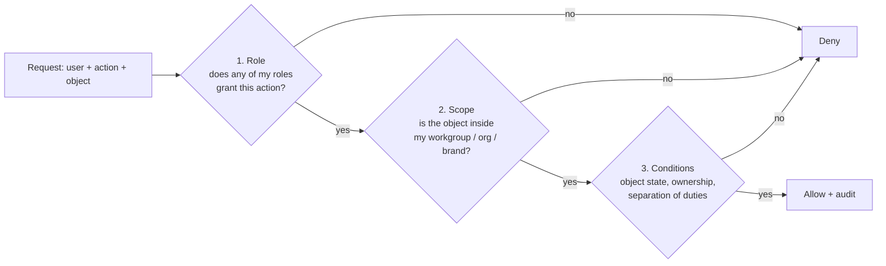
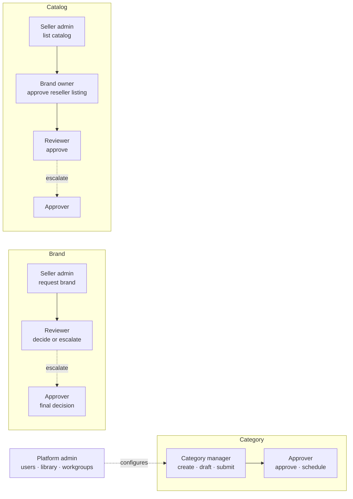

# 02 · Roles and permissions

Authorisation has three layers. A request is allowed only if **all three** say yes.

1. **Role (RBAC):** what kind of thing a user may do. Users hold one or more roles.
2. **Scope:** where they may do it. Platform-side roles are scoped to **workgroups** (a set of category subtrees). Seller-side roles are scoped to a **seller organisation** (and optionally a division), and brand-owner powers are scoped to the **brands** that organisation owns.
3. **Conditions (ABAC):** rules on the object itself. Examples: a drafter can edit a category version only while it is `DRAFT`; the approver of a version must not be the person who submitted it; a reseller can edit only the *offer* of a paired catalog, never the product facts.

## Role catalogue (R0.1: 8 roles)

R0 shipped the 18 roles of the reference process. R0.1 merged them into **8**, keeping a second person
only where the flows need an independent check. Every category, brand and catalog step still has an owner.

### Platform side

| Role | Scope | Can do | Replaces |
| --- | --- | --- | --- |
| `platform_admin` | Global | Users, role grants, audit, plus shared configuration: attribute library, flag profiles, workgroups. Never approves business requests. | platform admin, template manager, workgroup manager |
| `category_manager` | Workgroup | Create and move category nodes; draft and check flags, specs and rules; submit versions for approval. | category creator, drafter, checker |
| `approver` | Workgroup (categories) / global | Approve and schedule category versions; decide escalated vendor, brand and catalog cases; assign work; revive brands. Never on their own work. | category approver, agency manager, marketplace manager, committee member |
| `reviewer` | Global | First-line review of vendor assessments, brand requests and catalogs: approve, reject, ask for info, escalate. | VA officer, brand specialist, product reviewer |
| `auditor` | Global, read-only | Reads everything, writes nothing. | auditor |

### Seller side

| Role | Scope | Can do | Replaces |
| --- | --- | --- | --- |
| `seller_admin` | Own organisation | Organisation profile and users; brand requests, catalogs, offers, certificates. | seller admin, lister, pricing |
| `seller_staff` | Own organisation | Brand requests, catalogs and offers; not organisation settings. | (optional sub-users) |
| `brand_owner` | Brands the org owns | Owner-level catalog edits, authorise resellers, approve reseller catalogs. **Derived** after OEM assessment, never granted by hand. | brand owner |

### Who does each step

### Separation of duties

| Rule | Enforced by |
| --- | --- |
| Platform admin cannot also be approver, reviewer or auditor | grant validation |
| Reviewer and approver are different people (escalation needs a second person) | grant validation |
| Auditor cannot hold any other role | grant validation |
| Nobody approves what they submitted or edited | ability conditions on every approve action |

What we gave up: the separate drafter/checker pair inside one category team. The approver remains the independent
check on every category version, and change history shows who edited what.

### Demo team

`/setup` (and Admin → Users → *Rebuild demo team*) creates five demo accounts besides the platform admin:
`category-manager@`, `approver@`, `reviewer@`, `seller@` (reseller org) and `oem-seller@` (OEM org).
Admins can set passwords for demo accounts only; real users always reset their own.

## Permission matrix (MVP)

`C` create · `R` read · `U` update · `S` submit · `A` approve/decide · `—` none.

| Object \ Role | platform_admin | category_manager | approver | reviewer | seller_admin / staff | brand_owner |
| --- | --- | --- | --- | --- | --- | --- |
| Users, role grants | CRU | — | — | — | — | — |
| Attribute library, flag profiles, workgroups | CRU | R | R | — | — | — |
| Category node | R | CRU | R | R | R | — |
| Category version (draft) | R | RUS | R | R | — | — |
| Category version (in review) | R | R (withdraw) | RA | R | — | — |
| Category version (published) | R | R | R | R | R | — |
| Vendor assessment | — | — | RA | RA | — | — |
| Brand request | — | — | RA | RA | CRUS (own org) | — |
| Catalog | — | — | RA | RA | CRUS (own org) | RUA (own brand) |
| Offer | — | — | R | R | CRU (own org) | — |
| Escalation | — | — | RA | C R | — | — |
| Audit trail | R | — | — | — | — | — |

## Conditions worth writing down now

| Rule | Where it bites |
| --- | --- |
| A user cannot approve anything they created, edited or checked in the same request (maker ≠ checker ≠ approver) | Category versions, brand and catalog reviews |
| Only one person can hold the edit lock on a draft at a time | Category workbench, catalog editor |
| A published category version is read-only for everyone; changes create a new draft version | Category versions |
| Product facts on a catalog can only be edited by its owner; paired sellers edit their own offer only | Catalogs |
| Send-back always returns to the person who forwarded the request | All review flows |
| Seller sub-users can only list in categories granted to their division | Catalog creation |
| Auditors never write | Everywhere |

## Implementation notes

- Policies live in one package (`packages/authz`) as typed, unit-tested rules, and are evaluated **on the server for every API call**. The UI uses the same rules only to hide buttons; it never enforces them.
- Every allow/deny on a governed action is logged with the policy that decided it.
- See [ADR 0006](../adr/0006-auth-and-authorization.md) for the library choice.
