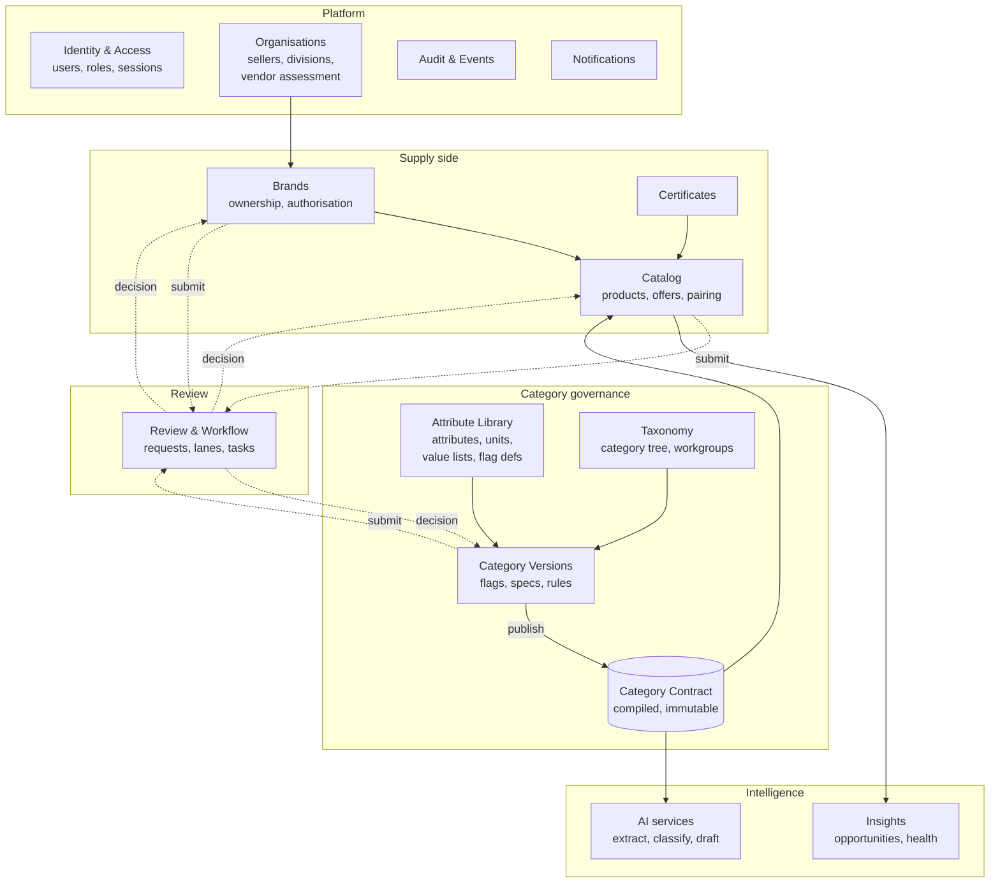
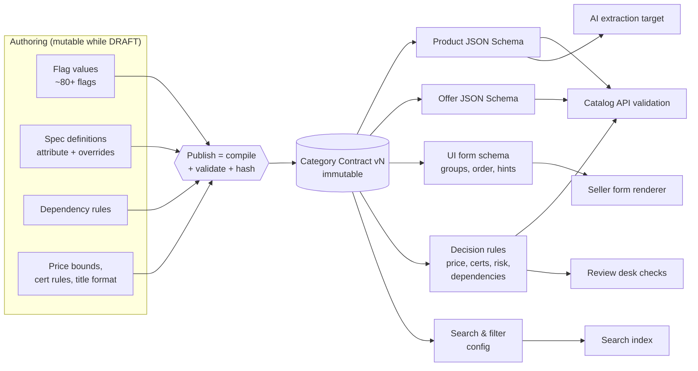
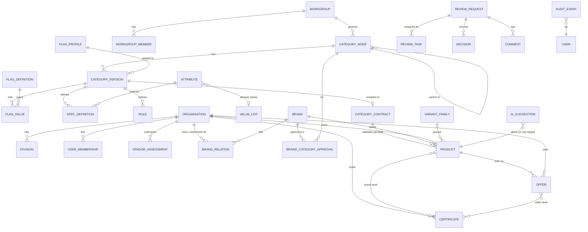

# 03 · Domain model

## Bounded contexts

The system is split into modules that each own their data and talk through clear interfaces. They start inside one deployable (a modular monolith, see [ADR 0001](../adr/0001-modular-monolith.md)) and can be split out later without redesign.



| Module | Owns | Main consumers |
| --- | --- | --- |
| Identity & Access | users, sessions, role grants | everything |
| Organisations | seller orgs, divisions, addresses, vendor assessment results, OEM status | Brands, Catalog |
| Attribute Library | attribute definitions, units, value lists, flag definitions, flag profiles, certificate types | Category Versions |
| Taxonomy | category tree (L1–L5), codes, aliases, workgroups | Category Versions, search |
| Category Versions | per-version flag values, spec definitions, dependency and pricing rules; the publish step | Category Contract |
| Category Contract | the compiled, immutable "rulebook" of a published version | Catalog, AI, Review, search |
| Brands | brands, trademarks, ownership and authorisation relations, brand-category approvals | Catalog |
| Certificates | seller certificate library, validation status | Catalog, Review |
| Catalog | products (shared facts), offers (per seller), pairing, variant families | Review, Insights, Buyer (later) |
| Review & Workflow | review requests, lanes, tasks, decisions, SLAs, send-backs | all submitters |
| AI services | suggestions with confidence, extraction jobs, embeddings | Catalog, Category Versions, Review |
| Insights | opportunity signals, category health metrics | Seller app, admin console |
| Audit & Events | append-only audit log, outbox of domain events | everyone (read), auditors |

## The central idea: the Category Contract

Everything is related because **category configuration is the program that the rest of the platform runs**. Instead of every module reading raw config tables and re-interpreting flags its own way, publishing a category version **compiles** it into one immutable artefact: the Category Contract.



What a contract contains:

| Part | Built from | Used by |
| --- | --- | --- |
| `productSchema` (JSON Schema) | spec definitions, attribute datatypes, value lists, units, regex | API validation, AI extraction target, bulk upload validation |
| `offerSchema` (JSON Schema) | pricing / stock / serviceability flags | offer editor, bulk price & stock update |
| `uiSchema` | spec groups, ordering, hints, importance badges, conditional visibility | seller form renderer (one generic renderer for all categories) |
| `rules` (decision graphs) | dependency rules, price bounds, certificate applicability, discount bands, risk inputs | API, form (live hints), review checks |
| `titleTemplate` | custom title format | title generator |
| `filters` | importance (filterable / L1-impacting), preference direction, range display | search and buyer filters (later) |
| `flagsSnapshot` | every flag value, resolved from profile + overrides | anything that needs a raw flag |
| `hash` + `version` | whole contract | pinning, caching, diffing |

Why this matters:

- **One source of truth.** The browser, the API, the bulk validator and the AI extractor all validate against the same schema, so they can never disagree.
- **Catalogs pin a contract version.** A catalog created against v3 stays valid against v3 even after v4 is published.
- **Diffing contracts drives maintenance.** When v4 is published, diffing v3 → v4 tells us exactly which catalogs are affected and how (no action / auto-migrate / acknowledge / edit). See [05 · Workflows](05-workflows.md).
- **Testable.** A contract can be unit-tested with sample products before publish (the "synthetic catalog sandbox").

## Flags are data, not columns

There will be dozens of configuration flags, and the list will change. So flags are **defined as data** in the Attribute Library by the template manager, not as database columns.

```ts
// Illustrative shape
type FlagDefinition = {
  key: 'price_label' | 'allowed_buying_modes' | 'stock_required' | string;
  group: 'category' | 'seller' | 'buyer' | 'marketplace' | 'transactional';
  ownerModule: 'catalog' | 'brand' | 'review' | 'bid' | 'fulfilment';
  valueSchema: JSONSchema;          // what a valid value looks like
  default: unknown;                 // used when no profile/override sets it
  editableBy: Role[];               // e.g. transactional flags are read-only for category team
  effects: string[];                // documentation: which contract parts it feeds
};
```

A category version stores `flag_values(version_id, flag_key, value jsonb)`. A **flag profile** is a named bundle of flag values; a version picks a profile and stores only overrides. The compiler resolves *default → profile → parent category → version override*.

### How a few flags travel through the system

| Flag (example) | Set by | Becomes in the contract | Effect downstream |
| --- | --- | --- | --- |
| Selling units (UoM) + decimal allowed | Drafter | `offerSchema` quantity type and precision | Offer editor, stock and MOQ validation |
| Price label = offer price with MRP, discount 5–40% | Drafter | rule `price.offer_within_mrp_band` | Live hint on price field, API rejection, review check |
| Price bounds at spec level (tree of LoVs) | Drafter | rule `price.spec_bounds` | Same as above, per spec combination |
| Certificates required (BIS by IS code, mandatory/either-or) | Drafter | rule `certs.required` | Seller certificate step, review checklist |
| Allowed sellers / land-border rule | Drafter | rule `eligibility.seller` | Catalog creation gate, brand request gate |
| Allow customisation | Drafter | extra spec group in `productSchema` | Customisable specs section |
| Bulk upload allowed | Drafter | `features.bulkUpload` | Bulk upload door shown or hidden |
| AI checks: warning vs error | Drafter | `ai.severity` per check | Whether an AI finding blocks submit |
| Custom title format | Drafter | `titleTemplate` | Generated product titles |
| Buying modes (direct, L1, bid) | Drafter | `commerce.modes` | Buyer side (later) |
| Mandatory product approval | Drafter | rule `review.requirePA` | Review routing |

## Core entities (MVP)



Notes:

- **Product vs Offer.** `PRODUCT` holds the shared facts (brand, model, specs, media, brand-level certificates) and is owned by one organisation (the OEM when it exists). `OFFER` is one seller's price, stock, serviceability and seller-level certificates. Pairing = creating an `OFFER` on someone else's `PRODUCT`.
- **Spec values live in `PRODUCT.facts` (JSONB)**, validated against the pinned contract's `productSchema`, with generated columns / indexes for the attributes that are filterable. This keeps hundreds of categories with different specs in one table without an entity-attribute-value mess.
- **`REVIEW_REQUEST` is generic.** Category versions, brand requests, catalogs and vendor assessments all go through the same review engine with a `subject_type` + `subject_id`.
- **`AI_SUGGESTION`** stores every proposed value with model, confidence, source evidence and the human decision (accepted / edited / rejected). This is both the "never silent" guarantee and the training/feedback dataset.

## Identifiers and lifecycle states

| Object | States |
| --- | --- |
| Category version | `DRAFT → IN_REVIEW → APPROVED → SCHEDULED → PUBLISHED → SUPERSEDED` (plus `SENT_BACK`, `DISCARDED`) |
| Brand request | `DRAFT → SUBMITTED → IN_QUEUE → IN_REVIEW → (INFO_REQUESTED) → APPROVED / REJECTED_REQUEST / REJECTED_BRAND / WITHDRAWN` |
| Product (catalog) | `DRAFT → SUBMITTED → OWNER_REVIEW? → IN_REVIEW → PUBLISHED / REJECTED / NOTIFIED`; later `ACTION_REQUIRED`, `INACTIVE`, `SUSPENDED`, `DISCONTINUED` |
| Offer | `ACTIVE`, `EXPIRING_SOON`, `EXPIRED`, `NO_STOCK`, `SUSPENDED`, `REMOVED_BY_OWNER` |

Sellers see these collapsed into three buckets (**Live / Needs you / Not live**), as proposed in the enhancement playbook.

IDs are UUIDv7 internally (time-ordered, index-friendly) with human-readable public codes where users need them (`CAT-L5-…`, `BR-…`, `PRD-…`, `OFR-…`).
