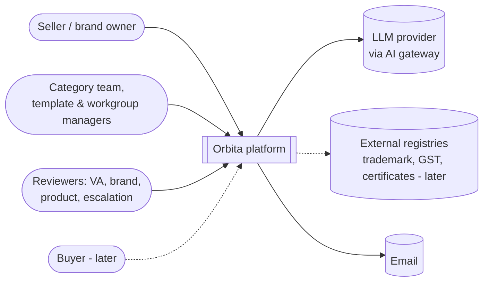
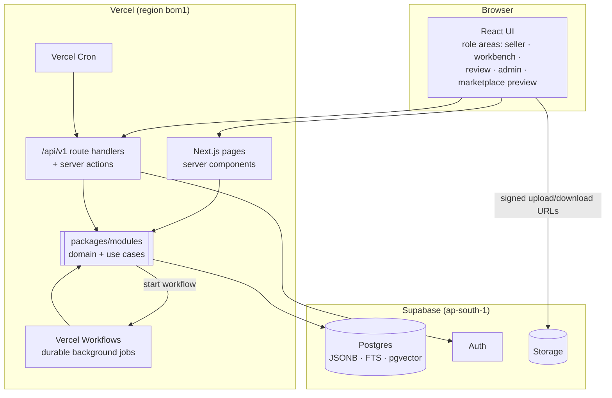
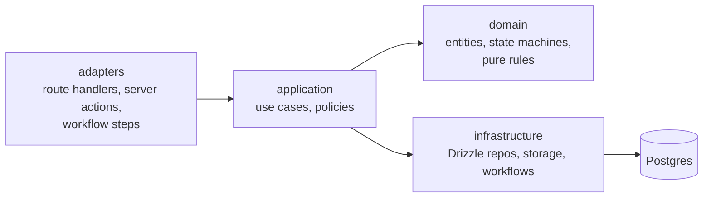
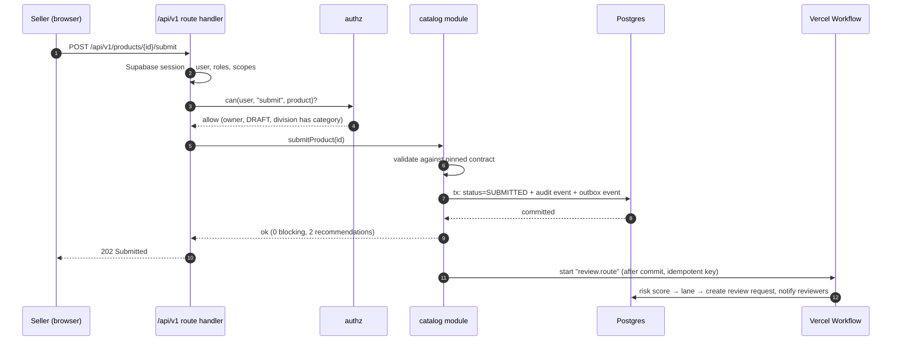

# 04 · System architecture

The platform is one Next.js application deployed on **Vercel**, backed by **Supabase** (Postgres, Auth, Storage). Business logic lives in framework-free TypeScript modules, so the HTTP layer is thin and replaceable. Deployment details and services: [09 · Deployment and services](09-deployment-and-services.md); decision: [ADR 0008](../adr/0008-vercel-and-supabase.md).

## Context (who talks to the system)



## Containers



| Part | Responsibility |
| --- | --- |
| **Next.js pages** | All UIs, server-rendered per role; heavy editors (spec builder, rule canvas, grids) as client components |
| **`/api/v1` route handlers** | The public, versioned HTTP API (used by the UI, bulk tools and, later, sellers' own systems). Thin: authenticate → authorise → call a module use case → return JSON. Zod-validated, OpenAPI documented |
| **Server actions** | Small UI-only mutations; they call the same module use cases, never the database directly |
| **`packages/modules/*`** | One module per bounded context with its own tables, use cases, domain rules and events. The only code that writes business data |
| **Vercel Workflows** | Durable multi-step jobs: SLA timers and reminders, AI extraction, contract compilation for big categories, version migration plans, bulk imports. They survive deploys and can sleep for days |
| **Vercel Cron** | Scheduled scans: offer staleness, certificate expiry, draft cleanup, scheduled publishes (per-minute on Pro, daily on Hobby) |
| **Supabase Postgres** | System of record: relational core, JSONB product facts, full-text and trigram search, pgvector embeddings |
| **Supabase Auth** | Identities, sessions, email/OTP login, MFA. Roles and scopes stay in our own tables |
| **Supabase Storage** | Images, documents, certificates, bulk files; browsers upload directly with signed URLs (Vercel bodies are capped at 4.5 MB) |

## Modules

```
packages/modules/
  identity/           role grants, scopes, user profile (auth itself is Supabase)
  organisations/      seller orgs, divisions, vendor assessment
  library/            attributes, units, value lists, flag definitions, profiles, certificate types
  taxonomy/           category tree, workgroups
  category-versions/  drafting, rules, publish → contract compiler
  brands/
  certificates/
  catalog/            products, offers, pairing, variants
  review/             generic review engine: requests, lanes, tasks, decisions, SLAs
  ai/                 suggestion store, extraction/classification tasks
  insights/           opportunities, health metrics
  audit/              audit log, outbox
```

Each module has the same layers, and only `infrastructure` knows about Drizzle, Supabase or Vercel:



Rules for staying modular:

1. A module only touches **its own tables**. Cross-module reads go through the other module's public interface; cross-module reactions go through **domain events** (outbox).
2. Domain logic (state machines, contract compiler, rule evaluation) has no framework imports, so it is unit-tested and also runs in the browser for live hints.
3. dependency-cruiser fails the build on illegal imports.

## How a write flows (example: seller submits a product)



If starting the workflow fails after commit, a cron job re-dispatches unprocessed outbox events, so no submission is ever lost.

## Cross-cutting concerns

| Concern | Approach |
| --- | --- |
| Audit | Every governed write appends to `audit_event` (actor, action, object, before/after diff, request id) in the same transaction |
| Versioning | Category versions immutable after publish; products pin `contract_id`; contract diffs drive maintenance |
| Concurrency | Optimistic locking (`version` column) + explicit edit locks for long editing sessions |
| Validation | Zod for API input; Ajv for contract JSON Schemas; decision rules for business logic; the same packages run in the browser |
| Files | Direct-to-Storage uploads with signed URLs; processing (thumbnails, checks) as workflow steps |
| Security | Server-side authorisation on every handler; Supabase secret key only on the server; RLS on Storage buckets; Vercel firewall rate limits on auth and write endpoints |
| Observability | Vercel logs and Workflows dashboard; Sentry for errors; request id in every log line |
| i18n | All UI strings through an i18n layer from R0 |

## Environments

| Env | App | Data |
| --- | --- | --- |
| Local | `pnpm dev` | Supabase CLI stack in Docker, seeded with demo data mirroring the prototype |
| Preview | Vercel preview deployment per pull request | Supabase **staging** project |
| Production | Vercel production from `main` | Supabase **production** project (Mumbai), backups + point-in-time recovery before real data |
