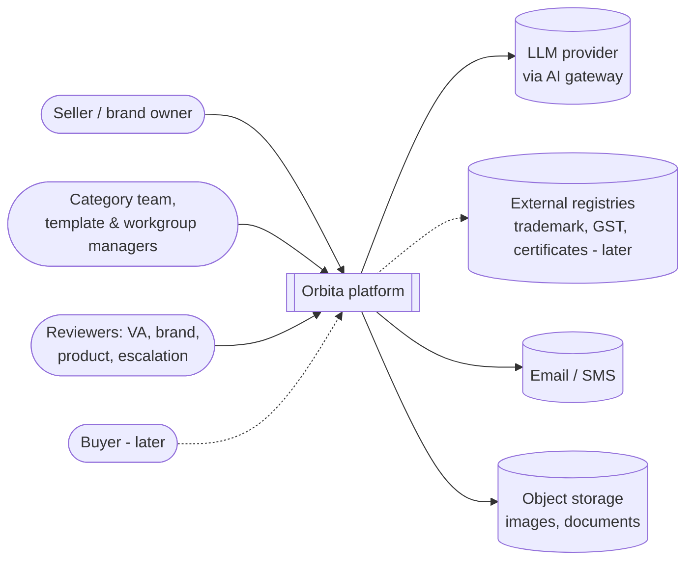
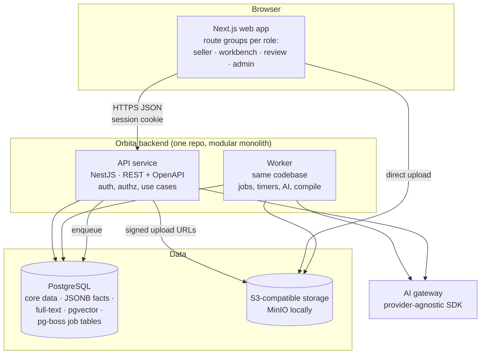
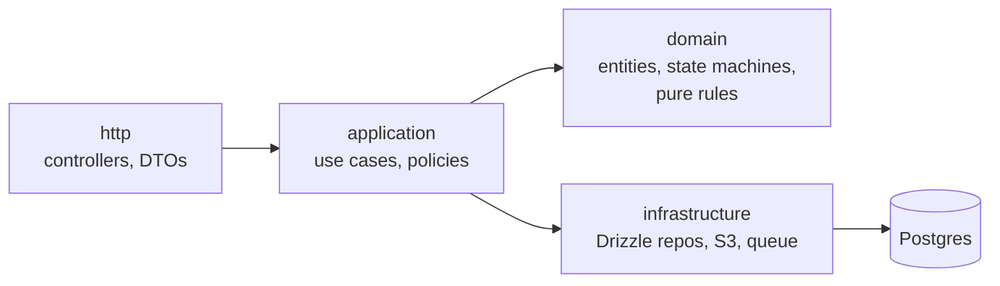
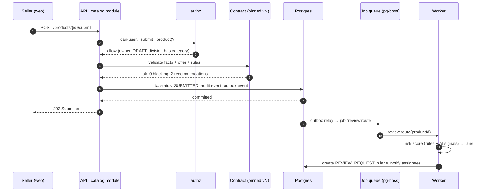

# 04 · System architecture

## Context (who talks to the system)



## Containers



| Container | Responsibility | Why separate |
| --- | --- | --- |
| **Web (Next.js)** | All UIs. Server-rendered pages per role, client components for heavy editors (spec builder, rule canvas, bulk grid) | One design system, one login, role-based navigation |
| **API (NestJS)** | The only writer of business data. Authentication, authorisation, validation against Category Contracts, use cases, audit | Keeps business rules out of the UI and makes them testable and reusable by bulk/API sellers |
| **Worker** | Background jobs: contract compilation, AI extraction, risk scoring, SLA timers, notifications, version migration plans, search indexing | Slow or scheduled work never blocks a request |
| **PostgreSQL** | System of record, plus JSONB, full-text search, trigram matching, pgvector embeddings, and the job queue tables | One database to run and back up at this stage |
| **Object storage** | Images, documents, certificates, bulk files | Large binaries out of the DB; browser uploads directly via signed URLs |

## Inside the backend: one module per bounded context

```
apps/api/src/modules/
  identity/        users, sessions, role grants
  organisations/   seller orgs, divisions, vendor assessment
  library/         attributes, units, value lists, flag definitions, profiles
  taxonomy/        category tree, workgroups
  category-versions/  drafting, rules, publish → contract compiler
  brands/
  certificates/
  catalog/         products, offers, pairing, variants
  review/          generic review engine: requests, lanes, tasks, decisions, SLAs
  ai/              suggestion store, extraction/classification jobs
  insights/        opportunities, health metrics
  audit/           audit log, outbox
```

Each module has the same internal layers:



Rules for staying modular inside one deployable:

1. A module only touches **its own tables**. Cross-module reads go through the other module's public service interface; cross-module reactions go through **domain events**.
2. Domain logic (state machines, contract compiler, rule evaluation) lives in **framework-free packages** (`packages/domain`, `packages/contract`) so it can be unit-tested and reused by the web app for live hints.
3. Lint rules (dependency-cruiser) fail the build if a module imports another module's internals.

## How a write flows (example: seller submits a catalog)



The **transactional outbox** (event row written in the same transaction as the state change) guarantees no event is lost and no job runs for a change that rolled back.

## Cross-cutting concerns

| Concern | Approach |
| --- | --- |
| Audit | Every governed write appends to `audit_event` (actor, action, object, before/after diff, request id) in the same transaction. Append-only; auditors read it |
| Versioning | Category versions immutable after publish; products pin `contract_id`; contract diffs drive maintenance |
| Concurrency | Optimistic locking (`version` column) on every editable aggregate + an explicit edit lock for long editing sessions (category drafts) |
| Validation | Zod for request DTOs; Ajv for contract JSON Schemas; ZEN decision graphs for business rules. Same packages run in the browser for live hints |
| Files | Browser uploads straight to object storage with short-lived signed URLs; virus scan + image processing as worker jobs |
| Observability | OpenTelemetry traces across web → API → worker; structured JSON logs with request id; error tracking |
| Config & secrets | Environment variables validated at boot; secrets from the host's secret store, never in the repo |
| i18n | All UI strings through an i18n layer from day one |

## Environments

| Env | Runs on | Notes |
| --- | --- | --- |
| Local | Docker Compose: Postgres (with pgvector), MinIO, Mailpit; apps via `pnpm dev` | Seeded with demo data that mirrors the Orbita prototype |
| Preview | One environment per pull request (later) | Spin up from Compose or a PaaS |
| Production | Containers on a managed platform in an Indian region; managed Postgres; S3-compatible storage | Start single-region; read replica and CDN later |
