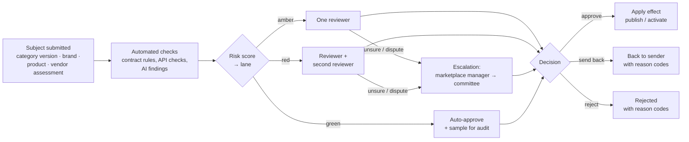
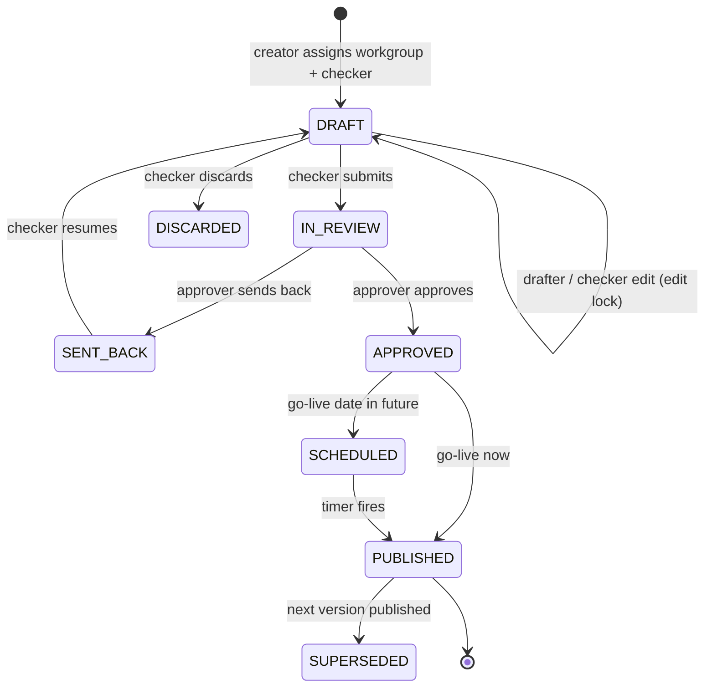
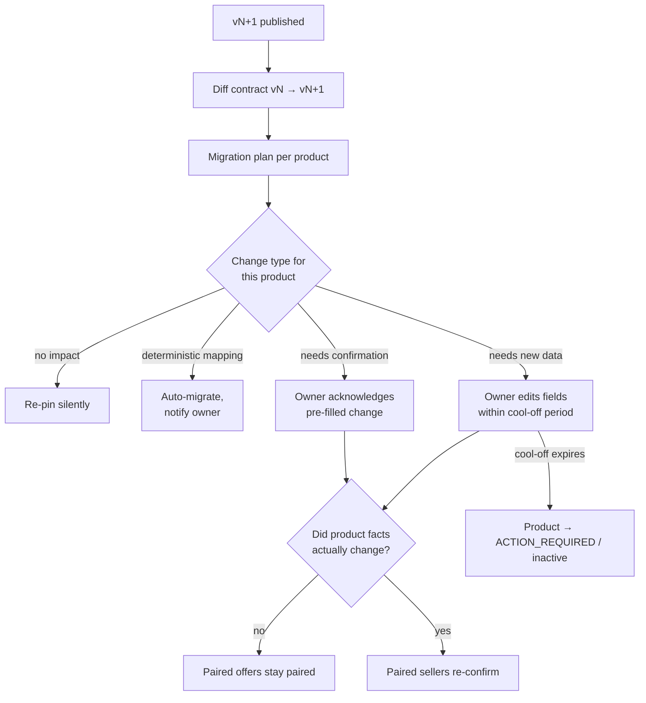
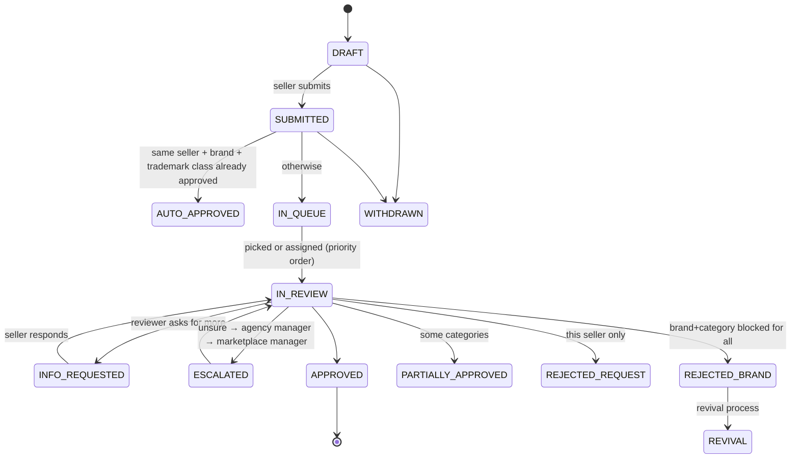
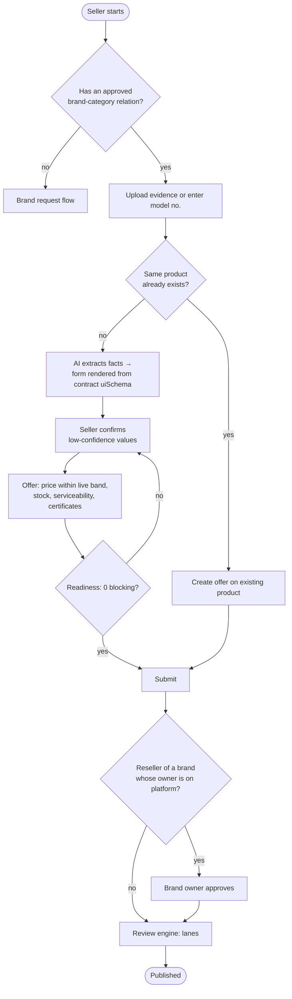

# 05 · Workflows

All approval-style processes run on **one generic review engine**. Category versions, brand requests, catalogs and vendor assessments differ only in their configuration: who reviews, which lanes exist, what the checks are and what "approve" does.

## The generic review engine



What a review **definition** declares (stored as data, editable by admins):

```ts
// Illustrative
const brandReview: ReviewDefinition = {
  subjectType: 'brand_request',
  lanes: {
    green: { reviewers: [], sampleRate: 0.1 },
    amber: { reviewers: ['brand_specialist'] },
    red:   { reviewers: ['brand_specialist', 'agency_manager'] },
  },
  escalation: ['marketplace_manager', 'committee_member'],
  riskRules: 'rules/brand-risk.json',      // ZEN decision graph
  checks: ['prohibited_name', 'trademark_owner_match', 'duplicate_brand'],
  sla: { amber: 'P2D', red: 'P5D' },        // ISO-8601 durations; timers in the worker
  sendBackTo: 'previous_actor',
  attemptsLimit: { per: ['seller', 'brand', 'category'], max: 3, cooldown: 'P30D' },
  reasonCodes: 'reason-codes/brand.json',
};
```

At MVP every lane except **amber** can be switched off, so the platform starts as "everything gets one reviewer" and the green/red lanes are turned on per category as confidence grows.

## Category version lifecycle



- **Publishing compiles the contract.** If compilation or the contract's own test cases fail, publishing is blocked.
- **Change classes** decide the path: *cosmetic* changes (hint text, labels) can be published by the checker; *minor* and *major* changes need the approver. The class is computed from the contract diff, not chosen by the user.
- **Separate go-live for sellers and buyers** (seller first, so catalogs exist before buyers arrive).

## What happens to catalogs when a new category version is published



## Brand request



Seller-side relationship paths (owner, manufacturer for owner, authorised reseller, unbranded) decide the evidence required; when the brand owner is already on the platform, an authorisation request goes to **their** dashboard instead of a reviewer.

## Product (catalog) creation



## Notifications and timers (worker jobs)

| Job | Trigger |
| --- | --- |
| `contract.compile` | Category version submitted / publish requested |
| `version.publish_scheduled` | Scheduled go-live time |
| `version.plan_migrations` | Version published |
| `review.route` | Any subject submitted |
| `review.sla_tick` | Every N minutes: escalate overdue tasks, rebalance load |
| `ai.extract_product` | Evidence uploaded |
| `certificate.expiry_scan` | Daily: reminders at configured offsets, inactivate on expiry |
| `offer.stock_staleness` | Daily: Expiring Soon → Expired per category rules |
| `draft.cleanup` | Daily: warn then delete stale drafts |
| `notify.*` | Any event with subscribers (email digest + in-app) |
