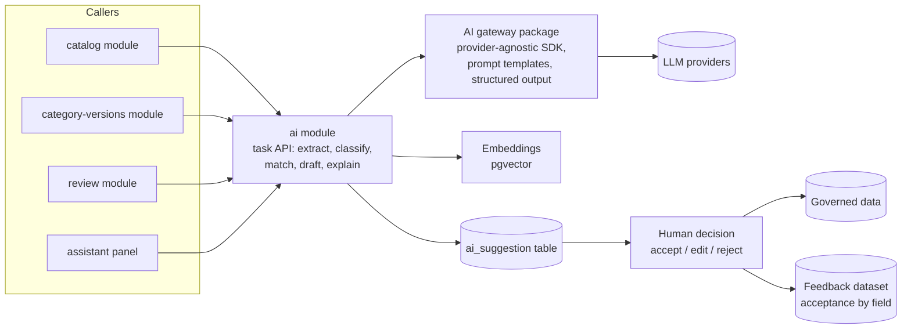

# 07 · AI architecture

**Rule: AI recommends, Orbita validates, humans review exceptions.** AI never writes a governed value directly. It writes *suggestions*; a person or a deterministic rule turns a suggestion into data.

## Where AI plugs in

| Capability | Input | Output | Phase |
| --- | --- | --- | --- |
| Product classification | photo, datasheet text, title | ranked category candidates + confidence | 2 |
| Spec extraction | datasheet PDF, product page, photo | values for the contract's `productSchema`, each with confidence + evidence span | 2 |
| LoV mapping | extracted free-text value | nearest allowed value, or "propose new value" | 2 |
| Title & description | confirmed facts + `titleTemplate` | text (never overwrites seller text silently) | 2 |
| Duplicate / same-product match | model no., facts, image embedding | candidate existing products to pair with | 2 |
| Image checks | uploaded images | background clean-up, category fit, model match, duplicates | 2 |
| Reviewer co-pilot | request + evidence + check results | draft decision + reason codes | 2 |
| Category drafter | category name, siblings, standards, datasheets | draft spec sheet, rules, flag profile | 3 |
| Opportunity signals | searches, bids, catalog coverage | ranked opportunities per seller | 3 |
| Seller / admin assistant | question + user's own data | answer, or a proposed action awaiting approval | 2–3 |

## Components

- **Structured output only.** Every AI task is asked to return JSON that validates against a schema (for extraction: the contract's own `productSchema`). Invalid output is retried or dropped, never shown.
- **Provider-agnostic.** All calls go through one gateway package, so models can be swapped per task (a strong model for extraction and drafting, a cheaper one for titles) and costs tracked per task.
- **Evidence stored.** Each suggestion keeps where it came from (document id, page, text span or image id), shown to the user as "because…".
- **Confidence bands.** Default: ≥ 0.75 pre-filled for one-click confirm, below that left for the human. Tuned per field from the acceptance data.
- **Severity from config.** Whether an AI finding warns or blocks comes from the category contract (`ai.severity`), not from code.

## Guardrails

| Guardrail | Implementation |
| --- | --- |
| Never silent | Suggestions live in `ai_suggestion`; only an explicit user action or a deterministic rule copies them into governed data |
| Explainable | Every suggestion and every risk score stores its inputs and evidence; reviewers can open "why" |
| Fair | Risk scores used for routing are logged with their features and periodically checked for bias against new and small sellers |
| Fallback | Every AI-assisted step has a manual path; AI outage degrades to the manual form |
| Agents ask first | Assistant actions that change data are shown as a proposed change and need the user's approval |
| Data boundaries | Prompts include only the requesting user's permitted data; no cross-seller leakage; PII minimised |
| Measured | Acceptance rate per field, reviewer–AI agreement rate per category, latency and cost per task on a dashboard |
