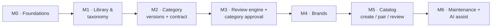

# 08 · Repository structure and build roadmap

## Target repository layout

```
my-own-marketplace/
├─ apps/
│  ├─ web/                  Next.js: all UIs
│  │  └─ app/
│  │     ├─ (auth)/         login, invite, reset
│  │     ├─ (seller)/       brand center, catalogs, offers, action centre, opportunities
│  │     ├─ (workbench)/    taxonomy, category versions, spec builder, rule canvas, publish
│  │     ├─ (review)/       review desk: queues, request detail, decisions
│  │     └─ (admin)/        users, roles, workgroups, attribute library, flag profiles, audit
│  ├─ api/                  NestJS REST API (modules per bounded context)
│  └─ worker/               NestJS standalone: pg-boss consumers
├─ packages/
│  ├─ ui/                   Orbita design system: tokens.css, Tailwind preset, components
│  ├─ domain/               framework-free entities, state machines, value objects
│  ├─ contract/             category contract compiler, differ, validators (Ajv)
│  ├─ rules/                decision-rule evaluation (ZEN) + rule fixtures
│  ├─ authz/                CASL abilities: roles, scopes, conditions
│  ├─ db/                   Drizzle schema, migrations, seed data
│  ├─ ai/                   AI gateway, prompt templates, structured-output schemas
│  ├─ api-client/           generated typed client from the API's OpenAPI spec
│  └─ config/               shared tsconfig, eslint, prettier presets
├─ infra/
│  └─ docker-compose.yml    postgres (pgvector), minio, mailpit
├─ prototype/orbita/        original prototype, reference only
├─ docs/                    architecture, ADRs, design system, brainstorm
└─ .github/workflows/       CI
```

## Build roadmap

Each milestone ends with something demoable end to end, in the Orbita look.



| Milestone | Delivers | Done when |
| --- | --- | --- |
| **M0 · Foundations** | Monorepo, Docker Compose, CI, `packages/ui` with Orbita tokens and app shell (sidebar, top bar, theme toggle, command palette), Better Auth login, role grants, seed users per role, audit log | You can log in as each role and see a role-specific empty home in the Orbita style |
| **M1 · Library & taxonomy** | Attribute library (datatypes, units, value lists), flag definitions and profiles, category tree with codes and aliases, workgroups and assignment | A template manager defines attributes and flags; a creator builds an L1–L5 tree and assigns a workgroup |
| **M2 · Category versions + contract** | Draft versions; flag editor with profiles and exceptions view; spec builder (pick from library, set importance/preference/selection/restriction); dependency rules; contract compiler, live preview of the seller form; contract tests | A checker publishes (no approval yet) and the compiled contract renders a working seller form preview |
| **M3 · Review engine + category approval** | Generic review engine, review desk UI, category approval flow with maker-checker-approver, send-back, scheduling, change classes | A version goes draft → review → approved → published with full audit trail |
| **M4 · Brands** | Seller organisations, vendor assessment (simplified), Brand Center (lookup first, relationship-first evidence), brand review with queues, auto-approval by trademark class | A seller gets a brand approved for a category; an OEM sees its brands |
| **M5 · Catalog** | Product + offer model, contract-driven create form, pair and clone, same-product check first, certificates library, catalog review (owner then product reviewer), seller statuses as three buckets | A reseller pairs an OEM product; a new product is created, reviewed and published |
| **M6 · Maintenance + AI** | Action Centre, stock/price rules and staleness jobs, category-version migration plans, AI extraction and classification with confidence and `ai_suggestion`, bulk price/stock grid | Publishing v2 of a category produces a correct migration plan; AI fills a product form from a datasheet |

After M6: risk-tiered lanes, variant families, opportunity engine, AI category drafter, buyer search.

## Immediate next steps

1. Agree the open questions in [`docs/brainstorm/open-questions.md`](../brainstorm/open-questions.md).
2. Scaffold **M0** (monorepo, compose, UI shell with Orbita tokens, auth, seed roles).
3. Model the Attribute Library and flag definitions in `packages/db` with seed data mirroring the prototype's Gaming Laptops category.
