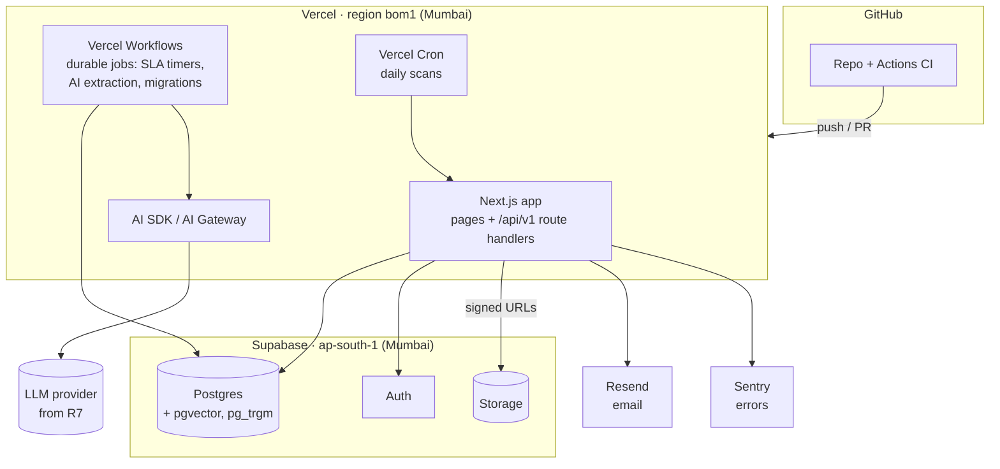

# 09 · Deployment and external services

**Target:** deploy from the GitHub repo to **Vercel**, with **Supabase** as the database, authentication and file storage. Everything else is a small set of add-on services. Decision record: [ADR 0008](../adr/0008-vercel-and-supabase.md).

## Do we need Supabase?

**Yes, or an equivalent.** Vercel hosts the Next.js app and its serverless functions, but it does not provide a relational database of its own; databases come from marketplace partners. Supabase is the best fit here because one service gives us:

| Need | Supabase provides |
| --- | --- |
| Relational database with JSON, full-text search, vectors | PostgreSQL with `pgvector` and `pg_trgm` |
| Login for staff and sellers | Supabase Auth (email/password, OTP/magic link, MFA) |
| Images, documents, certificates | Supabase Storage (S3-compatible) with signed upload URLs |
| Indian data location | **Mumbai region (`ap-south-1`)** is available ([Supabase regions](https://supabase.com/docs/guides/platform/regions)) |
| Simple setup with Vercel | Install from the Vercel Marketplace: environment variables (`POSTGRES_URL`, `SUPABASE_URL`, keys…) sync to the Vercel project and billing goes through Vercel ([Supabase docs](https://supabase.com/docs/guides/platform/vercel-marketplace)) |
| Local development | Supabase CLI runs the same stack locally in Docker |

Alternative: Neon (Postgres only) + a separate auth library + Vercel Blob. More pieces for the same result, so not recommended.

## What runs where

Key design consequences of running on Vercel (serverless):

- **No always-on API server or worker.** The API is Next.js route handlers (`/api/v1/*`) calling framework-free domain modules in `packages/`. Background work runs as **Vercel Workflows** (durable steps, sleeps and hooks that can wait minutes to months) and **Vercel Cron** for scheduled scans ([Workflow concepts](https://vercel.com/docs/workflows/concepts.md)).
- **Function limits matter.** Functions run up to 300 s on Hobby and up to 800 s on Pro; request and response bodies are capped at **4.5 MB** ([Vercel limits](https://vercel.com/docs/functions/limitations)). So files always upload **directly to Supabase Storage** with signed URLs, and long jobs (bulk uploads, AI extraction) run as workflow steps.
- **Database connections:** serverless functions connect through Supabase's connection pooler (transaction mode, prepared statements off), never with long-lived direct connections.
- **Same region:** set the Vercel function region to Mumbai (`bom1`) next to the Supabase project, so each query stays in-region.

## Accounts and services needed

| Service | Needed from | What for | Plan for build / demo | Plan for pilot and production |
| --- | --- | --- | --- | --- |
| **GitHub** | Now | Code, pull requests, CI | Free | Free (or Team for private-repo features) |
| **Vercel** | R0 | Hosting, preview deployments per PR, Workflows, Cron, logs | **Hobby (free)**: personal, non-commercial use only; cron at most once a day; 300 s functions | **Pro: $20 per developer seat / month** + usage; required for commercial use, per-minute cron, 800 s functions ([Hobby vs Pro](https://vercel.com/docs/plans/hobby), [cron limits](https://vercel.com/docs/cron-jobs/usage-and-pricing)) |
| **Supabase** | R0 | Postgres, Auth, Storage | **Free**: 500 MB database, 1 GB storage, 50K monthly active users, **pauses after 1 week of inactivity** | **Pro: $25 / month** base (8 GB database, 100K MAU, no pausing; compute add-ons extra) ([pricing guide](https://makerkit.dev/blog/saas/supabase-pricing)) |
| **Resend** (or any SMTP) | R0 | Invites, password reset, review notifications | Free tier | Paid tier as volume grows; needs a verified sending domain |
| **Sentry** | R0 | Error tracking with user and route | Free developer tier | Team plan if needed |
| **Domain name** | Before pilot | e.g. `orbita.in`, email sending domain | Not required (use `*.vercel.app`) | Yearly registrar fee |
| **LLM provider** (via Vercel AI Gateway or direct) | R7 | Extraction, classification, co-pilot | Pay per use, small | Pay per use; set spend limits |
| Search service (Meilisearch / Typesense / OpenSearch) | R9, only if Postgres search is not enough | Buyer search at scale | — | Optional |

**Nothing else is required.** No separate server, no Redis, no Docker hosting. Docker is only needed on a developer's machine to run the local Supabase stack.

### Rough monthly cost

| Stage | Services | Approximate cost (USD) |
| --- | --- | --- |
| Building and demoing (R0–R5) | Vercel Hobby, Supabase Free, Resend free, Sentry free | **$0** (non-commercial; Supabase project pauses if unused for a week) |
| Pilot (after R5) | Vercel Pro (1 seat), Supabase Pro, Resend, domain | **~$45–70** + usage |
| Production with AI (R7+) | Above + LLM usage + more Vercel seats/compute | **~$70–150** + AI usage, growing with traffic |

Prices are from the sources linked above as of October 2026 and exclude taxes; check current pricing before committing.

## Environments

| Environment | Vercel | Supabase | Notes |
| --- | --- | --- | --- |
| Local | `pnpm dev` | Supabase CLI (Docker) | Seeded demo data |
| Preview (every PR) | Preview deployment | Shared **staging** project (Supabase branching later, if needed) | Migrations applied to staging on merge to `main` |
| Production | Production deployment from `main` (or a `release` branch once live) | **Production** project, Mumbai | Point-in-time recovery add-on before real data |

## Environment variables

| Variable | Source |
| --- | --- |
| `POSTGRES_URL` (pooled), `POSTGRES_URL_NON_POOLING` (migrations) | Supabase (synced by the integration) |
| `NEXT_PUBLIC_SUPABASE_URL`, `NEXT_PUBLIC_SUPABASE_PUBLISHABLE_KEY` | Supabase |
| `SUPABASE_SECRET_KEY` | Supabase (server only, never exposed to the browser) |
| `RESEND_API_KEY`, `EMAIL_FROM` | Resend |
| `SENTRY_DSN`, `SENTRY_AUTH_TOKEN` | Sentry |
| `AI_GATEWAY_API_KEY` or provider key | Vercel AI Gateway / LLM provider (R7) |
| `APP_BASE_URL` | Per environment |
| `CRON_SECRET` | Generated; protects cron endpoints |

## What you need to do, and when

| When | Action |
| --- | --- |
| Before R0 starts | Create a **Vercel** account with GitHub login and import the `my-own-marketplace` repo (Hobby is fine). From the Vercel Marketplace add **Supabase**, choose region **Mumbai**. Create a **Resend** account and a **Sentry** account. Share nothing secret in chat; keys go into Vercel/GitHub settings |
| During R0 | Add GitHub Actions secrets for CI (database URL for the test project) |
| Before the pilot | Upgrade Vercel to Pro and Supabase to Pro; buy the domain; verify the email sending domain; turn on Supabase backups / point-in-time recovery |
| R7 | Create the LLM provider / AI Gateway key and set a monthly spend limit |
