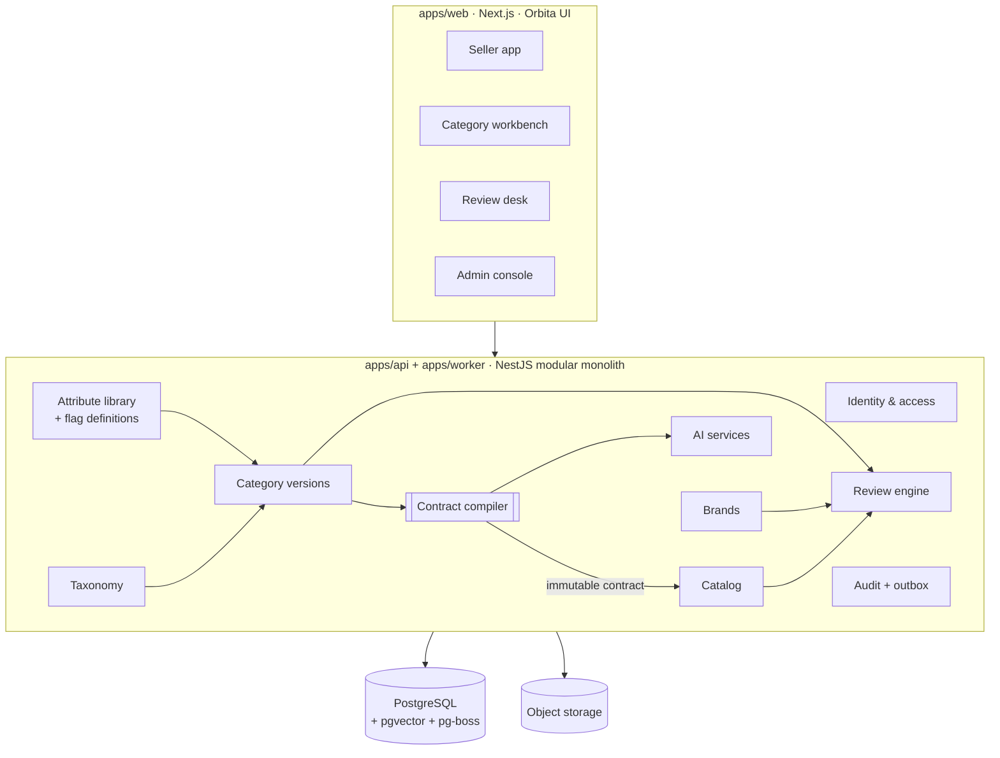

# Architecture

Start here. Read in order the first time.

| Doc | What it answers |
| --- | --- |
| [01 · Vision and scope](01-vision-and-scope.md) | What we are building, for whom, and what is in the MVP |
| [02 · Roles and permissions](02-roles-and-permissions.md) | Every role, what it can do, and how permission checks work |
| [03 · Domain model](03-domain-model.md) | Modules, entities, and the **Category Contract** that ties config to catalogs |
| [04 · System architecture](04-system-architecture.md) | Containers, module layout, request flow, cross-cutting concerns |
| [05 · Workflows](05-workflows.md) | Review engine, category versions, brand and catalog flows, background jobs |
| [06 · Tech stack](06-tech-stack.md) | What we use for each layer and why |
| [07 · AI architecture](07-ai-architecture.md) | Where AI plugs in, and the guardrails |
| [08 · Repo structure and roadmap](08-repo-structure-and-roadmap.md) | Folder layout and milestones M0–M6 |

Related: [ADRs](../adr/README.md) · [Orbita design system](../design/orbita-design-system.md) · [Open questions](../brainstorm/open-questions.md)

## The architecture on one page

**The key idea:** publishing a category version compiles all its flags, specs and rules into an immutable **Category Contract**. Every downstream part (seller forms, API validation, bulk upload, AI extraction, review checks, search, version migrations) reads that contract, so configuration changes behaviour consistently everywhere, with no code changes.
