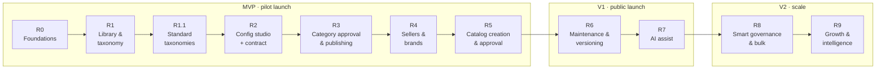

# Release plan: category, brand and catalog

The whole platform (category, brand and catalog end to end, for every role) is delivered in **10 releases (R0–R9)** plus two point releases (**R0.1** roles consolidation, **R1.1** standard taxonomies), grouped into three launch milestones. Each release is usable and demoable on its own, and each one builds only on releases before it.

## The releases at a glance

| Release | Theme | Main users | What becomes possible | Indicative size |
| --- | --- | --- | --- | --- |
| [R0](R0-foundations.md) | Foundations | Developers, platform admin | Log in as any role on a deployed Orbita-styled shell; audit and permissions in place | 2 sprints |
| [R1](R1-library-and-taxonomy.md) | Attribute library & taxonomy | Platform admin, category manager | Define attributes, units, value lists, flags, flag profiles; build the category tree; set up workgroups | 2 sprints |
| [R1.1](R1.1-standard-taxonomy.md) | Standard taxonomies | Platform admin, category manager | Variable-depth tree (groups and listing categories); adopt categories from Shopify and UNSPSC with their attributes; category attribute sets; UNSPSC mapping | 1 sprint |
| [R2](R2-category-config-studio.md) | Category configuration studio + contract | Drafter, checker | Configure flags and specs with inheritance, starting from the category's attribute set; define dependency, price and certificate rules; compile a contract and preview the seller form | 3–4 sprints |
| [R3](R3-category-approval-and-publishing.md) | Category approval & publishing | Checker, approver | Draft → review → approve → schedule → publish with maker-checker-approver, versions and audit | 2 sprints |
| [R4](R4-sellers-and-brands.md) | Seller onboarding & brands | Seller admin, VA officer, brand specialist, agency manager, OEM | Seller organisations and users; vendor assessment; Brand Center; brand review with queues and escalation | 3 sprints |
| [R5](R5-catalog-creation-and-approval.md) | Catalog creation & product approval | Seller, OEM, product reviewer | Create / pair / clone products against a contract; Shopify-style variants (options from the attribute set); offers, certificates, serviceability; OEM + product approval; read-only marketplace preview | 4–5 sprints |
| [R6](R6-maintenance-and-versioning.md) | Catalog maintenance & category versioning | Sellers, OEMs, category team | Offer lifecycle and staleness; Action Centre; new category versions migrate catalogs; standard taxonomy upgrades (diff and apply); brand renewals; bulk price/stock | 3 sprints |
| [R7](R7-ai-assist.md) | AI assist | Sellers, reviewers | Fill products from a datasheet or photo; classify; titles; image checks; reviewer co-pilot; Orbit AI assistant | 3 sprints |
| [R8](R8-smart-governance-and-bulk.md) | Smart governance & bulk | Reviewers, admins, large sellers | Risk lanes (green/amber/red); change classes; bulk variant matrices; bulk create; admin health dashboard | 3–4 sprints |
| [R9](R9-growth-and-intelligence.md) | Growth & intelligence | Sellers, category team | Opportunity engine; AI category drafter (adopt-first); demand-led category pipeline; public API; Google Merchant feeds via Shopify mappings; Hindi | 3 sprints |

*Sizes assume 2-week sprints and a small team (1–2 developers using AI coding tools). They are planning estimates to sequence work, not commitments. Re-estimate each release at its kickoff.*

## Milestone gates

| Milestone | Releases | Gate to pass before moving on |
| --- | --- | --- |
| **MVP · pilot** | R0–R5 | A pilot group (2–3 category teams, 10–20 sellers) runs the full chain: category published → brand approved → catalog created → reviewed → visible in the marketplace preview. No data fix needed by developers during the pilot. |
| **V1 · public launch** | R6–R7 | Catalogs survive a category version change without manual clean-up; sellers can keep offers fresh; AI fills at least the mandatory specs for pilot categories with sellers accepting most values. Security review and load test passed. |
| **V2 · scale** | R8–R9 | Review effort per request falls measurably after risk lanes are enabled; opportunity cards drive new catalogs. |

## How features map to releases

| Capability | R0 | R1 (+R1.1) | R2 | R3 | R4 | R5 | R6 | R7 | R8 | R9 |
| --- | --- | --- | --- | --- | --- | --- | --- | --- | --- | --- |
| Login, roles, audit | ● | | | | ◐ seller orgs | | | | | |
| Attribute library, units, value lists | | ● | | | | | | | | |
| Flags and flag profiles | | ● defs | ● values | | | | | | | |
| Category tree, workgroups | | ● | | | | | | | | |
| Standard taxonomies (Shopify, UNSPSC), category attribute sets | | ● R1.1 | ● pre-fill | | | ● variants | ● upgrades | ● classify | | ● feeds |
| Spec builder, dependency rules | | | ● | | | | | | | ◐ AI drafter |
| Price, certificate, eligibility rules | | | ● | | | ● enforced | | | | |
| Category Contract compiler + preview | | | ● | ● publish | | ● consumed | ● diff | ● AI target | | |
| Review engine | | | | ● category | ● brand | ● product | | ● co-pilot | ● risk lanes | |
| Seller orgs, VA | | | | | ● | | | | | |
| Brands | | | | | ● | | ● renewals | | | |
| Products, offers, pairing | | | | | | ● + variants | ● lifecycle | ● AI fill | ● bulk variants | |
| Certificates | | | | | ◐ library | ● | ● expiry | ● extraction | | |
| Marketplace preview (read-only) | | | | | | ● | | | | ◐ search |
| Notifications | ◐ email | | | ● | ● | ● | ● | | ● digests | |
| Opportunities | | | | | | | | | | ● |

● = delivered · ◐ = partial

## Out of scope for all ten releases

**Services** listing categories (decided 2026-10-30: Orbita lists physical products). Buyer checkout, orders, payments, invoicing, bidding/tenders, contract management, and logistics. The platform is designed to plug them in later (buying-mode flags and offer data are already modelled), but they are a separate programme of work.
