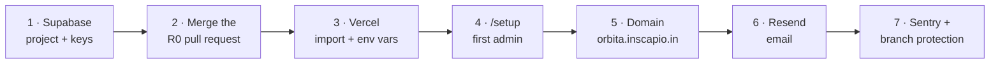

# Deploying Orbita (R0): step by step

This is everything you do by hand. Claude writes the code; you create the accounts, paste keys and merge PRs.
Total time: about 45 minutes, most of it waiting for DNS.

Steps 1–4 give you a working app at `https://<project>.vercel.app`. Steps 5–7 make it production-grade.

---

## 1 · Supabase project (Mumbai)

The app's users, logins, roles and audit trail live in Supabase.

1. **Region.** Use **South Asia (Mumbai)** (`ap-south-1`) so the database sits next to Vercel's Mumbai functions
   (`bom1`, set in `apps/web/vercel.json`). If your project is in another region and still empty, delete it
   (Project Settings → General → *Delete project*) and create a new one:
   - **Name:** `orbita-marketplace`
   - **Region:** South Asia (Mumbai)
   - **Database password:** letters and digits only (no `@ : / ? #`), at least 20 characters. Save it in your password manager.

   > Keeping a non-Mumbai project also works, but every database call travels further. If you keep it, change
   > `"regions": ["bom1"]` in `apps/web/vercel.json` to the Vercel region nearest to it (Sydney is `syd1`).

2. **Switch off public sign-up.** Authentication → **Sign In / Providers** → **Email**:
   - *Allow new users to sign up*: **off** (staff are invited by an admin)
   - *Confirm email*: **on**

3. **Copy four values** into a note (you paste them into Vercel in step 3):

   | Name | Where in the Supabase dashboard |
   | --- | --- |
   | `NEXT_PUBLIC_SUPABASE_URL` | Project home → *Project URL* (`https://<ref>.supabase.co`) |
   | `NEXT_PUBLIC_SUPABASE_PUBLISHABLE_KEY` | Project Settings → **API Keys** → *Publishable key* (`sb_publishable_…`) |
   | `SUPABASE_SECRET_KEY` | Project Settings → **API Keys** → *Secret keys* → create/reveal (`sb_secret_…`). **Never share this.** |
   | `DATABASE_URL` | **Connect** button (top bar) → *Connection String* → **Transaction pooler** → copy, then replace `[YOUR-PASSWORD]` with your database password |

   The `DATABASE_URL` looks like
   `postgresql://postgres.<ref>:<password>@aws-1-ap-south-1.pooler.supabase.com:6543/postgres`.
   Port **6543** matters: that is the pooler that serverless functions need.

You do **not** need to create tables. The first Vercel build runs the migrations.

## 2 · Merge the R0 pull request

Vercel builds the `main` branch, and the app code arrives on `main` with the R0 PR.

1. Open the PR on GitHub and wait for the **CI** check (lint, typecheck, tests, build) to go green.
2. Review, then **Merge**.

## 3 · Vercel project

1. Go to [vercel.com](https://vercel.com) → **Sign up with GitHub** (the *Hobby* plan is fine while building).
2. **Add New… → Project → Import** `anuragsinghv25-lab/my-own-marketplace`. If it is not listed, click
   *Adjust GitHub App permissions* and give Vercel access to that repo.
3. On the configure screen:
   - **Root Directory:** click *Edit* and choose **`apps/web`**. (This is the only setting you must change.)
   - Framework: Next.js (detected). Leave build and install commands as they are; `apps/web/vercel.json` sets them.
4. Open **Environment Variables** and add these for **all environments**:

   | Key | Value |
   | --- | --- |
   | `NEXT_PUBLIC_SUPABASE_URL` | from step 1 |
   | `NEXT_PUBLIC_SUPABASE_PUBLISHABLE_KEY` | from step 1 |
   | `SUPABASE_SECRET_KEY` | from step 1 |
   | `DATABASE_URL` | from step 1 |
   | `SETUP_TOKEN` | any long random string, e.g. from a password generator. Used once in step 4. |
   | `NEXT_PUBLIC_MARKETPLACE_NAME` | `Orbita` |
   | `NEXT_PUBLIC_DEMO_MODE` | `true` (shows demo-account hints on the login page; remove for real users) |

5. Click **Deploy**. The build log shows `[migrate] Up to date` and then the Next.js build. It takes about 2 minutes.

   Check: open `https://<your-project>.vercel.app/api/v1/health`. It should say `"status":"ok","database":"ok"`.

## 4 · Create the first platform admin

1. Open `https://<your-project>.vercel.app/setup`. Every connection should show a green tick
   (Email shows grey until step 6; that is fine).
2. Enter the `SETUP_TOKEN`, your name, email and a password.
3. Leave **Create the demo team** ticked and choose a demo password. You get five accounts:
   `category-manager@`, `approver@`, `reviewer@`, `seller@` and `oem-seller@example.com`.
4. Sign in at `/login`. You land on **Admin console**.

`/setup` refuses to run again once an admin exists. You can now delete `SETUP_TOKEN` from Vercel.

**Try the R0 exit demo:** Admin → Users → *Invite user* → tick *Category manager* → *Send invite*. Until email is
connected (step 6) you get a one-time link to copy. Open it in a private window, set a password, and you land in the
**Category workbench** with only the workbench menu. Toggle dark mode. Back as admin, open **Audit log**: the invite,
the role grant and the activation are there.

## 5 · Your domain: orbita.inscapio.in

1. Vercel → your project → **Settings → Domains** → *Add* → `orbita.inscapio.in`.
2. Vercel shows a DNS record, usually **CNAME** `orbita` → `cname.vercel-dns.com` (use exactly what it shows).
3. Add that record wherever `inscapio.in`'s DNS is managed (your registrar, Cloudflare, or Vercel). On Cloudflare set
   the record to **DNS only** (grey cloud).
4. Wait until Vercel shows *Valid Configuration* (minutes to an hour). HTTPS is automatic.
5. Add `APP_URL` = `https://orbita.inscapio.in` (Production environment) in Vercel → Environment Variables.
   This is the address used in emailed links.
6. Supabase → Authentication → **URL Configuration**: *Site URL* = `https://orbita.inscapio.in`, and add
   `https://orbita.inscapio.in/auth/confirm` to *Redirect URLs*.
7. Vercel → Deployments → latest → **Redeploy** so the new variable takes effect.

## 6 · Email with Resend (invites, sign-in links, password resets)

1. Sign up at [resend.com](https://resend.com) (free plan).
2. **Domains → Add domain** → `inscapio.in` (region: any; Mumbai if offered).
3. Resend lists 3–4 DNS records (an MX and TXT on a `send` subdomain for SPF, a TXT `resend._domainkey` for DKIM,
   optionally DMARC). Add them where you added the CNAME in step 5, then click **Verify**.
   These records sit on subdomains and do not affect any email you already receive at `inscapio.in`.
4. **API Keys → Create** (permission: *Sending access*, domain: `inscapio.in`). Copy the `re_…` key.
5. Vercel → Environment Variables (all environments):
   - `RESEND_API_KEY` = the key
   - `EMAIL_FROM` = `Orbita <no-reply@inscapio.in>`
6. Redeploy. Invites now arrive by email in the Orbita style, and the *Email link* tab on the login page switches on.

## 7 · Error tracking and branch protection (recommended)

**Sentry** (optional, free plan): sentry.io → *Create project* → platform **Next.js** → copy the DSN. Add
`SENTRY_DSN` and `NEXT_PUBLIC_SENTRY_DSN` (same value) in Vercel and redeploy. Server and browser errors then
appear in Sentry with the user id and request id.

**Protect `main`** on GitHub: repository → Settings → **Rules → Rulesets → New branch ruleset** → target `main` →
enable *Require a pull request before merging* and *Require status checks to pass* → add **Lint, typecheck, test, build**.

---

## What runs where

| Piece | Service | Notes |
| --- | --- | --- |
| Web app and `/api/v1` | Vercel (Mumbai `bom1`) | Every PR gets a preview URL |
| Database, logins | Supabase (Mumbai) | One database shared by previews and production for now |
| Migrations | Vercel build (`pnpm run vercel-build`) | Applied before each build. Keep them additive. |
| Email | Resend | Without it, admins get copyable invite links |
| Errors | Sentry + Vercel logs | Logs are JSON lines with a `requestId` |

## After each release

| Release | One-time step after the deploy |
| --- | --- |
| R0.1 | Admin → Users → *Rebuild demo team* if you used the old demo accounts |
| R1.1 | The migration renames custom category codes (`10101510-01` → `C10.10.15.10.01`) and turns old L5 nodes into listing categories; nothing to do. Then Admin → **Standard taxonomies** → *Load Shopify 2026-10* (a few seconds). Optional: download the UNSPSC codeset (Excel) and upload it on the same page |

## Troubleshooting

| Symptom | Fix |
| --- | --- |
| Build fails at `[migrate]` with *password authentication failed* | `DATABASE_URL` still has `[YOUR-PASSWORD]`, or the password has special characters. Reset the database password (Supabase → Project Settings → Database) to letters and digits and update the variable. |
| Build fails at `[migrate]` with a timeout | Use the **Transaction pooler** string (host ends in `pooler.supabase.com`), not the *Direct connection*. |
| `/setup` shows a red database line | Same as above; redeploy after fixing the variable. |
| Invite link says *expired* | Links work once and expire after 24 h. Admin → Users → open the person → *Resend invite*. |
| Someone was deactivated but is still in | Their next page load signs them out. Supabase access tokens also expire within an hour. |
